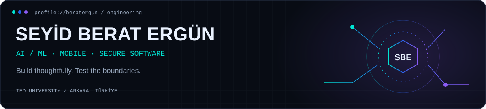

<!--
  SEYID BERAT ERGÜN — GITHUB PROFILE
  Compact engineering portfolio | AI/ML · Security · Mobile
  Reuses existing repository assets. No new images or scripts required.
-->

  

   

  
  
  

   
  

---

## `0x00 // ABOUT`

**Computer Engineering @ TED University** · Ankara, Türkiye · **Expected graduation: 2027**

I build **cross-platform applications**, explore **AI/ML systems**, and approach software with a focus on **security, testing and reliability**. I value working features, readable code and clear evidence over inflated claims.

<table>
<tr>
<td width="33%" valign="top"><b>01 · BUILD</b> Mobile apps · APIs · Product UX</td>
<td width="33%" valign="top"><b>02 · VALIDATE</b> Device QA · Regression · Security</td>
<td width="34%" valign="top"><b>03 · EXPLORE</b> AI/ML · RAG · Local-first systems</td>
</tr>
</table>

**Now building:** **RadioTEDU** (mobile) · **[berXfit](https://github.com/beratergun/berXfit)** (personal product) · **PerDrobe** (senior capstone)

---

## `0x01 // REAL-WORLD EXPERIENCE`

### 📻 RadioTEDU · Mobile Engineering / Technical Team · 2026–Present

- **Android + iOS:** React Native / TypeScript screens, navigation, radio playback, channel switching and platform-specific fixes.
- **Product integration:** authentication/profile flows, notifications and API-connected features.
- **Quality:** Jest, regression testing, device QA, defect tracking and security-aware validation.
- **Delivery:** keeping Android stable while resolving iOS and backend-dependent issues.

Active development and QA; not every feature is deployed. Internal code and infrastructure stay private.

### 🏢 TPIC · Information Technologies Intern · Aug–Sep 2026

- Corporate IT workflows, controlled technical investigations and structured documentation.
- Validation, access-boundary awareness and reliability testing in internship/lab contexts.

### 📱 Tusdata · Software Development Intern · Summer 2025

- Built responsive **Flutter / Dart** UI components from **Figma** designs.
- Worked on **REST API integration**, debugging, testing and maintainable app structure.

---

## `0x02 // FEATURED PROJECTS`

<table>
<tr>
<td width="50%" valign="top">
  <h3>🏋️ <a href="https://github.com/beratergun/berXfit">berXfit</a></h3>
  <b>TYPESCRIPT · PWA · ANDROID</b>
  
Local-first fitness and nutrition tracker with workout logs, progress views, offline storage and backup/export.

  
<b>Public v3</b> · Further improvements in QA

  <a href="https://github.com/beratergun/berXfit">Source & releases</a>
</td>
<td width="50%" valign="top">
  <h3>👕 PerDrobe</h3>
  <b>TEDU CAPSTONE · AI/ML · 2026–27</b>
  
AI-assisted size, fit and styling recommendations across personal wardrobe and shopping workflows.

  
<b>In development</b> · FitAI / StyleAI / WardrobeAI concepts

  Planned features are not presented as shipped.
</td>
</tr>
<tr>
<td width="50%" valign="top">
  <h3>🛡️ <a href="https://github.com/beratergun/Cs50-Portfolio">PassGuard</a></h3>
  <b>PYTHON · FLASK · SQLITE</b>
  
CS50x password-strength analysis project with backend routing, scoring and saved analysis history.

  <a href="https://github.com/beratergun/Cs50-Portfolio">Project overview</a>
</td>
<td width="50%" valign="top">
  <h3>🌐 <a href="https://sberatergun.com">SBE Portfolio</a></h3>
  <b>WEB · TECHNICAL WRITING</b>
  
Personal engineering portfolio featuring selected software projects, labs and technical articles.

  <a href="https://sberatergun.com">Visit website</a>
</td>
</tr>
</table>

### `ENGINEERING LABS // OPEN SOURCE`

| Repository | Focus |
|:--|:--|
| [ML Eval Studio](https://github.com/beratergun/ml-eval-studio) | Classifier metrics · thresholds · calibration |
| [RAG Eval Workbench](https://github.com/beratergun/rag-eval-workbench) | Retrieval metrics · evaluation fixtures |
| [LLM Guardrail Studio](https://github.com/beratergun/llm-guardrail-studio) | Local rule-based safety experiments |
| [Graph Optimizer Lab](https://github.com/beratergun/graph-optimizer-lab) | Prim · Kruskal · deterministic tests |

<b>Explore more projects</b>

 

- [Secure API Policy Lab](https://github.com/beratergun/secure-api-policy-lab) — authorization and defensive API patterns
- [Model Drift Monitor](https://github.com/beratergun/model-drift-monitor) — model/data drift experiments
- [AI Engineering Knowledge Base](https://github.com/beratergun/artificial-intelligence) — curated AI systems, agents and evaluation references
- [All public repositories](https://github.com/beratergun?tab=repositories)

---

## `0x03 // TECHNICAL TOOLKIT`

  
   
  

**Primary work:** Mobile development · API integration · QA & debugging  
**Developing depth:** AI/ML evaluation · Cybersecurity · Software architecture

---

## `0x04 // TECH COMMUNITY`

- **RadioTEDU** — Technical team; mobile application and digital media workflows.
- **TEDU Google developer club** — Technical & organization teams.
- **TEDU Chess Club** — Design team.
- **TEDU Cybersecurity Society** — Member; technical learning and peer activities.

<b>Education, credentials and more</b>

 

**TED University** — B.Sc. Computer Engineering (in progress, expected 2027)

- **Harvard University** — CS50x: Introduction to Computer Science (2026)
- **HKUST** — Software Engineering: Implementation & Testing; Software Design & Project Management; UML Modeling (2026)
- **Huawei** — Cloud Developer Training Program (2025)
- **Princeton University** — Programming with a Purpose (2024)
- **Universidad de Palermo** — Object-Oriented Programming with Java (2024)

**Additional leadership:** Competitive table tennis team captain (2015–2023).

---

  <code>DESIGN → BUILD → TEST → HARDEN → SHIP</code>
    
  <a href="https://sberatergun.com">sberatergun.com</a> · <a href="https://github.com/beratergun?tab=repositories">Projects</a> · <a href="https://www.linkedin.com/in/seyid-berat-erg%C3%BCn/">LinkedIn</a>

