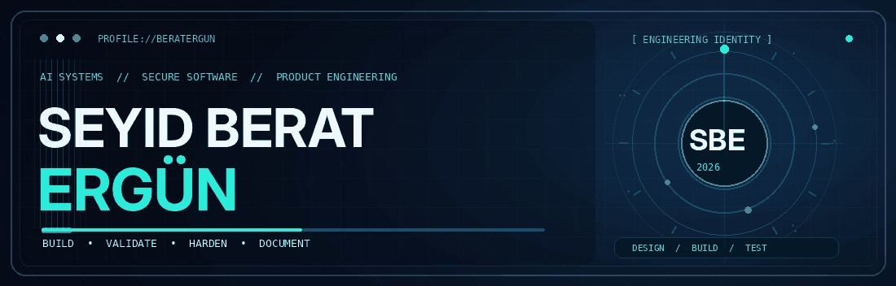
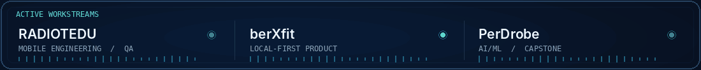

<!-- Seyid Berat Ergün | Engineering Portfolio | github.com/beratergun -->
<!-- Animated GIFs are repository-local: no JS, external APIs, or dynamic statistics. -->

  
  <h3>Engineering intelligent systems. Designing for reliability.</h3>
  <a href="./assets/sbe-hero-preview.png">View still banner</a> · <a href="./assets/active-workstreams-preview.png">View still workstreams</a>
  
<b>Computer Engineering @ TED University</b> AI/ML Systems · Cross-Platform Engineering · Secure Software · Quality Engineering

  

    
    
    
  

---

## `0x00 // ENGINEERING PROFILE`

I'm **Seyid Berat Ergün**, a fourth-year **Computer Engineering student at TED University**, Ankara, Türkiye (expected graduation: **June 2027**).

I work at the intersection of **intelligent applications, reliable software and real product delivery**. My work spans cross-platform mobile applications, API-driven systems, software quality and security-aware engineering, alongside experiments in AI/ML evaluation and local-first products.

| BUILD | VALIDATE | EXPLORE |
|:--|:--|:--|
| React Native, TypeScript, Flutter, APIs | Regression testing, device QA, reproducible issues | AI/ML systems, local models, RAG evaluation, security |

  

**Currently focused on:** the **RadioTEDU mobile ecosystem**, the **berXfit** application and the **PerDrobe** university capstone.

> Understand → Design → Build → Validate → Harden → Document.

---

## `0x01 // FIELD EXPERIENCE`

### 📻 RadioTEDU — Technical Team Member / Mobile Application Engineering
**2026–Present · TED University · React Native, TypeScript, Android & iOS**

Contributing to the development, maintenance and QA of a cross-platform university radio application and its connected product workflows.

- **Mobile product development:** Implementing and refining screens, navigation, player states, media playback, channel transitions and platform-specific behaviors.
- **Feature engineering:** Working on profile and authentication flows, study-related screens, notification preferences and interactive radio features.
- **API and backend integration:** Investigating and preparing client–server contracts, error states and integration requirements. Related backend work includes Node.js/Express, TypeScript and PostgreSQL.
- **QA and reliability:** Performing Jest-based regression checks, static analysis, platform-specific debugging and Android device acceptance testing; documenting defects and release blockers.
- **Security-aware delivery:** Examining authorization-dependent behavior, input handling, permission flows and failure paths; protecting a working Android baseline while iOS issues are resolved.

**Project status:** active engineering and QA. Some features depend on live backend/infrastructure changes and are **not described as released**. Internal repositories and operational details are intentionally not exposed here.

### 🏢 TPIC — Information Technologies Intern
**19 August–15 September 2026 · 20 working days · Gölbaşı, Ankara**

**Turkish Petroleum International Company (TPIC)** · Information Technologies

- Gained hands-on experience with corporate IT workflows, systems-oriented problem solving and technical documentation.
- Worked on controlled technical exercises and investigations around application and infrastructure workflows, validation and operational reliability.
- Applied security-conscious thinking to access boundaries, error handling and administrative processes.
- Practiced clear documentation of findings, assumptions and the distinction between testing environments and production operations.

**Scope:** internship work and controlled exercises. No claim of production deployment or disclosure of employer-internal systems.

### 📱 Tusdata — Software Development Intern
**Summer 2025 · Ankara, Türkiye · Flutter / Dart**

- Developed modular Flutter components and adapted Figma designs to responsive application interfaces.
- Integrated frontend modules with APIs, including structured data exchange, application state and validation.
- Used scenario-based testing, debugging and refactoring to improve usability and maintainability.

---

## `0x02 // SELECTED ENGINEERING PROJECTS`

<table>
<tr>
<td width="50%" valign="top">

### 🏋️ [berXfit](https://github.com/beratergun/berXfit)
**PERSONAL PRODUCT · TYPESCRIPT · PWA / ANDROID**

A privacy-conscious, local-first fitness and nutrition companion featuring meal and exercise logs, progress tracking, workout guidance, offline data and backup/export workflows.

**Engineering focus:** persistence, UI state, accessibility, device QA and protection against data loss.

**Status:** public v3 release; ongoing development and QA for subsequent improvements.

[Repository & releases](https://github.com/beratergun/berXfit) · [Web app](https://beratergun.github.io/berXfit/)

</td>
<td width="50%" valign="top">

### 👕 PerDrobe
**TEDU CAPSTONE · CMPE 491–492 · IN PROGRESS**

AI-assisted fashion and fit recommendation concept combining body/fit preferences, personal style, wardrobe organization and multi-brand product discovery.

**Planned modules:** FitAI, StyleAI, WardrobeAI, ShopAI and exploratory 3D fitting.

**Status:** academic capstone under development. Planned features are not represented as shipped implementations.

</td>
</tr>
<tr>
<td width="50%" valign="top">

### 🛡️ [PassGuard](https://github.com/beratergun/Cs50-Portfolio)
**HARVARD CS50x CAPSTONE · PYTHON / FLASK / SQLITE**

Password-strength analysis web application with server-side routing, assessment history, responsive controls and persistent UI preferences.

**Status:** documented academic project; course solution code is kept private for academic-integrity reasons.

</td>
<td width="50%" valign="top">

### 🌐 [SBE Portfolio](https://sberatergun.com)
**PERSONAL WEBSITE · ENGINEERING IDENTITY**

Personal portfolio bringing together selected software projects, technical focus, professional experience and contact information.

**Focus:** approachable information architecture, readable presentation and clear project provenance.

</td>
</tr>
</table>

### `PUBLIC LABS // REVIEWABLE CODE`

| Project | Engineering signal |
|:--|:--|
| [ML Eval Studio](https://github.com/beratergun/ml-eval-studio) | Classification metrics, threshold sweeps, calibration bins and invalid-input validation |
| [RAG Eval Workbench](https://github.com/beratergun/rag-eval-workbench) | Precision@K, Recall@K, MRR, nDCG and limited lexical-groundedness measurement |
| [LLM Guardrail Studio](https://github.com/beratergun/llm-guardrail-studio) | Local, explainable text safety rules; clearly documented prototype limitations |
| [Graph Optimizer Lab](https://github.com/beratergun/graph-optimizer-lab) | Prim, Kruskal, Union-Find, deterministic tests and algorithmic trade-offs |
| [Secure API Policy Lab](https://github.com/beratergun/secure-api-policy-lab) | Access-control and API security-policy explorations |
| [Model Drift Monitor](https://github.com/beratergun/model-drift-monitor) | Model/data drift monitoring experiments |
| [AI Engineering Knowledge Base](https://github.com/beratergun/artificial-intelligence) | Curated resources on AI systems, agents, RAG, evaluation and deployment |

[Explore all public repositories](https://github.com/beratergun?tab=repositories)

---

## `0x03 // TECHNICAL STACK`

  
   
  

| Domain | Experience and areas of active development |
|:--|:--|
| **Mobile engineering** | React Native, TypeScript, Flutter/Dart, Android/iOS differences, state handling and UI responsiveness |
| **Backend & data** | REST API integration, Node.js/Express, PostgreSQL, ASP.NET Core exposure, SQL/MySQL, validation |
| **Quality** | Jest, TypeScript checks, regression testing, defect reports, device QA, release readiness |
| **AI / ML** | Evaluation metrics, local-model experimentation, RAG assessment, classification, human-in-the-loop design |
| **Security** | Secure coding principles, input validation, authentication flows, authorization boundaries and failure-path analysis |
| **Foundations** | Java, Python, C, algorithms, data structures, OOP, Git, VHDL and digital systems |

Technologies above represent a mixture of applied work, projects and ongoing study—not identical proficiency across every item.

---

## `0x04 // TECH COMMUNITY & LEADERSHIP`

| Community | Role | Contribution focus |
|:--|:--|:--|
| **RadioTEDU** · TED University | **Technical Team Member** | Mobile application, digital media workflows, troubleshooting and technical coordination |
| **TEDU Google Developer community / club** | **Technical & Organization Teams** | Developer community participation, event organization and technical collaboration |
| **TEDU Chess Club** | **Design Team Member** | Creative materials and visual communication for club activities |
| **TEDU Cybersecurity Society** | Member since 2023 | Security learning, technical discussions and peer exchange |

<b>Additional leadership</b>

**Competitive Table Tennis — Team Captain (2015–2023).** Team coordination and tournament preparation; Ankara regional first-place results, junior mentoring and competitive decision-making.

---

## `0x05 // EDUCATION & SELECTED TRAINING`

**TED University** · B.Sc., Computer Engineering (in progress) · **Expected June 2027**

- **Harvard University:** CS50x — Introduction to Computer Science (April 2026)
- **The Hong Kong University of Science and Technology:** Software Engineering — Implementation & Testing, Software Design & Project Management, UML Modeling (May 2026)
- **Huawei:** Cloud Developer Training Program (December 2025)
- **Universidad de Palermo:** Object-Oriented Programming with Java (November 2024)
- **Princeton University:** Computer Science: Programming with a Purpose (October 2024)

<b>More training</b>

- Java Data Structures & Algorithms + LeetCode Exercises (March 2026)
- TED University — Academic Production and Institutional Processes with Artificial Intelligence

---

## `0x06 // SYSTEM PRINCIPLES`

**01 / Understand the problem.** Model constraints, users and trust boundaries.  
**02 / Design for failure.** Validate assumptions, permissions and platform differences.  
**03 / Make work testable.** Prefer reproducible tests, clear findings and documented limitations.  
**04 / Release responsibly.** Distinguish prototypes, QA builds and live deployments.  
**05 / Improve deliberately.** Protect working behavior while iterating.

  
  DESIGN → BUILD → VALIDATE → HARDEN → DOCUMENT

---

## `0x07 // CONTACT & COLLABORATION`

  
  
  
    Ankara, Türkiye · Open to meaningful engineering collaborations.

