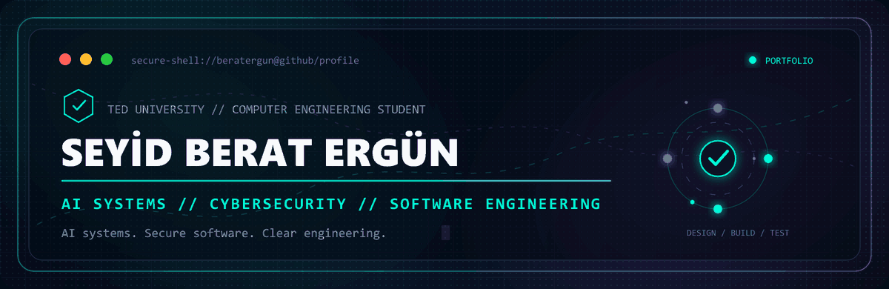
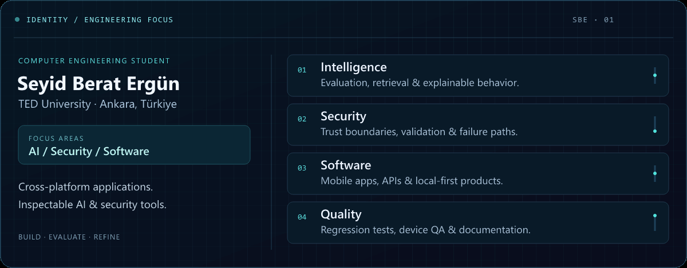

<!-- Seyid Berat Ergün · Engineering portfolio · repository-local visual assets -->

<div align="center">
  
  <br />
  <sub><a href="./assets/terminal-banner.png">Static banner</a></sub>
  <br /><br />
  <a href="https://sberatergun.com"></a>
  <a href="https://www.linkedin.com/in/seyid-berat-erg%C3%BCn/"></a>
  <a href="mailto:beratergun04@gmail.com"></a>
</div>

---

## `0x00 // IDENTITY & MISSION`

<picture>
  <source media="(prefers-reduced-motion: reduce)" srcset="./assets/identity-focus.png" />
  
</picture>

<details>
<summary>Read profile &amp; engineering focus as text</summary>

**Seyid Berat Ergün** · Computer Engineering Student at **TED University** · Ankara, Türkiye.

I build cross-platform applications and small, inspectable AI and security tools.

- **Intelligence:** evaluation, retrieval and explainable behavior.
- **Security:** trust boundaries, validation and failure paths.
- **Software:** mobile applications, APIs and local-first products.
- **Quality:** regression tests, device QA and clear documentation.

</details>


<sub>RadioTEDU and PerDrobe are in development. berXfit is a released personal product.</sub>

---

## `0x01 // FIELD EXPERIENCE`

### RadioTEDU · Technical Team / Mobile Engineering
<sub>2026–Present · React Native · TypeScript · Android / iOS</sub>

- Playback, channel switching, navigation and platform-specific fixes.
- API-integrated profile, authentication and notification features.
- Jest regression checks, device QA, issue tracking and release checks.

### TPIC · Information Technologies Intern
<sub>Aug–Sep 2026 · Enterprise IT · Controlled technical exercises</sub>

- Corporate IT workflows, infrastructure investigations and documentation.
- Validation of access boundaries, error handling and reliability.

### Tusdata · Software Development Intern
<sub>Summer 2025 · Flutter · Dart · REST APIs</sub>

- Responsive components adapted from Figma designs.
- API integration, debugging and reusable UI structure.

<sub>RadioTEDU remains in development and QA. TPIC work is described as controlled internship exercises.</sub>

## `0x02 // PROJECT OPERATIONS`

<table>
<tr>
<td valign="top" width="50%">
<b><a href="https://github.com/beratergun/berXfit">berXfit</a></b> &nbsp; <sub>PRODUCT / PUBLIC RELEASE</sub><br />
<sub>TypeScript · React · PWA / Android</sub><br /><br />
Local-first fitness and nutrition app. Workout logs, offline storage, progress tracking and data export.<br /><br />
<a href="https://github.com/beratergun/berXfit">Code & releases ↗</a> · <a href="https://beratergun.github.io/berXfit/">Web app ↗</a>
</td>
<td valign="top" width="50%">
<b>PerDrobe</b> &nbsp; <sub>UNIVERSITY CAPSTONE</sub><br />
<sub>AI / ML · Recommendation Systems</sub><br /><br />
In-progress fit, size and style recommendation project with wardrobe and multi-brand discovery concepts.<br /><br />
<sub>CMPE 491–492 · 2026–27</sub>
</td>
</tr>
<tr>
<td valign="top">
<b><a href="https://github.com/beratergun/Cs50-Portfolio">PassGuard</a></b> &nbsp; <sub>CS50x ACADEMIC PROJECT</sub><br />
<sub>Python · Flask · SQLite</sub><br /><br />
Password-strength analysis with assessment history and persistent UI preferences. Course solution code remains private.<br /><br />
<a href="https://github.com/beratergun/Cs50-Portfolio">Project overview ↗</a>
</td>
<td valign="top">
<b><a href="https://github.com/beratergun/llm-guardrail-studio">LLM Guardrail Studio</a></b> &nbsp; <sub>SECURITY LAB</sub><br />
<sub>Python · Local-first</sub><br /><br />
Explainable rule-based checks for prompt-injection patterns and sensitive-text review.<br /><br />
<a href="https://github.com/beratergun/llm-guardrail-studio">View repository ↗</a>
</td>
</tr>
</table>

<details>
<summary><b>More projects — explore the code</b></summary>
<br />

| Project | Technical focus |
|:--|:--|
| [RAG Eval Workbench](https://github.com/beratergun/rag-eval-workbench) | Retrieval metrics · evaluation fixtures |
| [Graph Optimizer Lab](https://github.com/beratergun/graph-optimizer-lab) | Prim · Kruskal · deterministic tests |
| [ML Eval Studio](https://github.com/beratergun/ml-eval-studio) | Classifier metrics · thresholds · calibration · deterministic tests |
| [Secure API Policy Lab](https://github.com/beratergun/secure-api-policy-lab) | API security · access-control policy |
| [Model Drift Monitor](https://github.com/beratergun/model-drift-monitor) | Model / data drift experiments |
| [AI Knowledge Base](https://github.com/beratergun/artificial-intelligence) | Papers · agents · RAG · evaluation resources |
| [SBE Portfolio](https://sberatergun.com) | Personal website · technical writing |

[**Browse all repositories ↗**](https://github.com/beratergun?tab=repositories)

</details>

### Technical writing

[**Local-First AI Assistant — Privacy, Routing & Guardrails ↗**](https://sberatergun.com/articles/local-first-ai-assistant-privacy-routing-guardrails)<br />
How deterministic routing, trust boundaries and controlled fallback shape a small AI application.

## `0x03 // SYSTEM INTERSECTION`


## `0x04 // TECHNICAL ARSENAL`

### `LANGUAGES & APPLICATIONS`

<p align="center"></p>


- **Languages:** TypeScript / JavaScript, Python, Java, Dart, C, SQL, VHDL.
- **Mobile:** React Native, Flutter, Android / iOS, state management.
- **Backend & web:** REST APIs, Node.js / Express, PostgreSQL, MySQL, HTML / CSS; ASP.NET Core exposure.
- **AI / ML:** Model evaluation, local models, RAG, algorithms and data structures.
- **Quality & security:** Jest, TypeScript checks, regression tests, secure design.
- **Tools:** Git / GitHub, VS Code, Android Studio, Figma.

### `TOOLS & WORKFLOW`

<p align="center"></p>

<details>
<summary><b>Security and reliability principles</b></summary>

```text
01  Define trust boundaries.
02  Validate inputs and assumptions.
03  Design failure paths alongside successful flows.
04  Preserve user data across offline and recovery flows.
05  Test edge cases and document known limits.
```

</details>

---

## `0x05 // COMMUNITIES & LEADERSHIP`

| Community | Role |
|:--|:--|
| **RadioTEDU** | Technical team · mobile application |
| **TEDU Google developer community** | Technical & organization teams |
| **TEDU Chess Club** | Design team |
| **TEDU Cybersecurity Society** | Member since 2023 · security learning |
| **Competitive Table Tennis** | Team captain · 2015–2023; Ankara regional first-place results, junior mentoring |

## `0x06 // EDUCATION & CERTIFICATIONS`

**TED University** — B.Sc. Computer Engineering (in progress; expected June 2027)

- **Harvard University** — CS50x, Introduction to Computer Science (April 2026)
- **HKUST** — Software Engineering: Implementation and Testing; Software Design and Project Management; Modeling Software Systems using UML (May 2026)
- **Huawei** — Cloud Developer Training Program (December 2025)
- **Princeton University** — Computer Science: Programming with a Purpose (October 2024)
- **Universidad de Palermo** — Object-Oriented Programming with Java (November 2024)
- **Additional training** — Java Data Structures & Algorithms + LeetCode Exercises (March 2026)
- **TED University** — Academic Production and Institutional Processes with Artificial Intelligence

## `0x07 // ENGINEERING WORKFLOW`


## `0x08 // COMMUNICATION CHANNELS`

<div align="center">
  <sub><a href="mailto:beratergun04@gmail.com">beratergun04@gmail.com</a> · Ankara, Türkiye</sub><br />
  <sub><code>THINK CLEARLY  /  BUILD DELIBERATELY  /  TEST THE EDGE CASES</code></sub><br />
  <sub><a href="https://sberatergun.com">sberatergun.com</a> &nbsp;·&nbsp; <a href="https://github.com/beratergun?tab=repositories">repositories</a> &nbsp;·&nbsp; <a href="https://www.linkedin.com/in/seyid-berat-erg%C3%BCn/">LinkedIn</a></sub>
</div>
